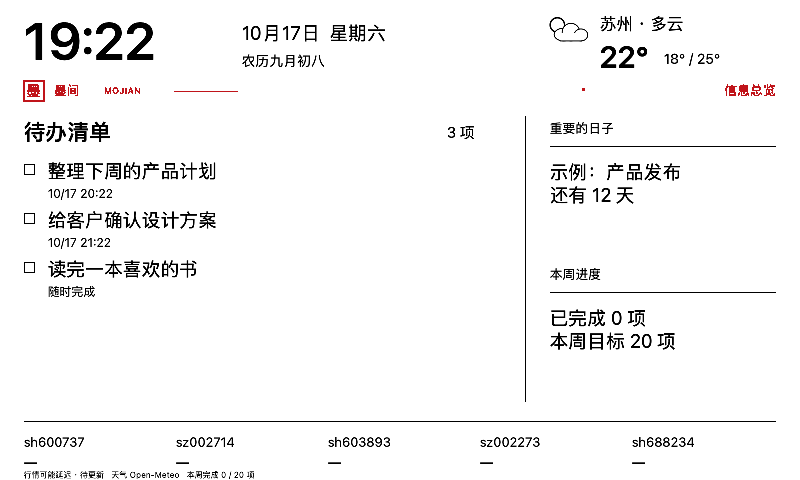

# 墨间 · MoJian

一块安静的办公墨水屏：让重要待办留在眼前，让工作与生活有自己的节奏。

**当前版本：Mac 0.4.7 / Android 0.7.7，开发验证阶段。** 原生 Mac 应用负责配置、数据与 Agent；ESP32 驱动 800×480 黑白红墨水屏。普通内容变化使用黑白分区局刷，红色仅用于固定品牌装饰。



> 图片是示例排版，不是实时天气、行情或用户真实清单。

## 当前能做什么

| 模块 | 能力 |
| --- | --- |
| 待办 | 新增、改名、改期、完成即消失、撤销完成、搜索与分类恢复历史、最多三项置顶、每天/工作日/每周/每月重复 |
| 屏幕布局 | 六套用途方案、多种排版及自定义，待办为主，行情为辅 |
| 信息卡片 | 重要日倒计时、本周完成/目标、下一场日程、出门天气、小纸条 |
| 天气与通勤 | 可配置城市，逐小时降雨概率、体感、风速，高德真实驾车耗时与路况 |
| 小行情 | 最多五支股票，黑色 `▲ +4.77%` / `▼ -9.99%` / `— 0.00%` |
| 工作与下班 | 作息或手动切换，下班显示公历、农历、节气、月历 |
| DeepSeek Agent | 官方 Harness、多步工具查询、偏好记忆、待确认操作、主动通勤提醒、停止与超时恢复 |
| 稳定性 | 本地保存、离线待同步、固定设备身份、IP变化自动找回、退避重连、发送队列合并、提醒去重 |
| 自主更新 | ESP32独立更新时间与当前天气，客户端退出后仍可运行 |
| 共享与扩展 | 可选自托管服务、习惯、模板、纯数据插件与待审留言 |
| 客户端 | Android 原生待办、布局、信息配置、工具助手、本地提醒与设备直连；另保留 Python 服务与网页 |

Mac 与 Android 均可独立通过局域网直连 ESP32，不需要同时运行 Python 服务。蓝牙用于设备发现和首次 Wi-Fi 配置，日常内容通过 Wi-Fi 传输。两端都有待办、场景、信息卡片与工具助手，部分能力仍有差异，见 [安卓说明](android/README.md)。

## 本轮更新

- **连接恢复**：首次连接记住屏幕身份，IP变化后自动寻找同一设备；Mac使用固定局域网名称，安卓使用系统NSD，采用地址前再次核对设备ID。
- **日常处理**：批量粘贴、安卓文字分享、截止时间快捷选项、历史记录搜索与确认恢复。
- **桌面体验**：六套离线用途方案、只读连接与数据诊断、每日收尾与摘要复制。

发现和搜索不会触发刷屏。重新连接不自动接管另一端布局；固件重启后仍需明确应用布局一次建立显示基准。屏蔽局域网组播时可通过蓝牙重新发现地址。各端历史文字尚未完整双向同步。

## 快速开始：Mac

支持 Apple Silicon，macOS 14 或以上。当前脚本只生成 arm64 应用。需要 Apple Command Line Tools、Python 3.12+、联网下载依赖；验证环境使用 macOS SDK 15.2。

在本仓库根目录执行：

```sh
# 1. 下载固定版本的官方 Node 运行时，并校验 SHA-256
python3 tools/prepare_agent_runtime.py

# 2. 用这个 Node 安装锁定的 Agent 依赖
export PATH="$PWD/agent-engine/runtime/bin:$PATH"
npm ci --prefix agent-engine

# 3. 构建并进行开发签名
sh tools/build_macos.sh

# 4. 运行隔离测试
sh tools/test.sh
```

应用生成到 `dist/墨间.app`。在 Finder 中打开，或拖入“应用程序”。脚本支持用 `MACOS_SDK` 指定 SDK 路径；构建问题见 [开发指南](docs/DEVELOPMENT.md)。

首次使用：

1. 打开“首次配置”，通过蓝牙发现工作台，或填写同一局域网内的设备地址，无需访问口令。新设备可按向导配网。
2. DeepSeek 和高德 Key 按需配置，保存在 Mac 钥匙串；手动待办与本地信息不依赖模型。
3. 选择布局，明确应用一次全刷，之后普通变化走局刷。
4. 在“信息卡片”选择附加内容；读取系统日历须主动授权并选择日历。
5. 在“作息与日历”设置工作时间，按需启用系统通知。

**不要把真实 Key、访问口令或 Wi-Fi 密码写进源码、截图、Issue 或提交。** 配置范例仅含占位符。

## 快速开始：Android

需要 JDK 17、Android SDK 35 和 Gradle 8.9：

```sh
export ANDROID_HOME=/path/to/android-sdk
export GRADLE_BIN=/path/to/gradle-8.9/bin/gradle
sh tools/build_android.sh
# 连接自己的Android设备后安装开发包
adb install -r dist/desk-todo-debug.apk
```

打开「我的 → 首次配置」连接工作台。通知、系统日历按需授权；完整功能与测试入口见 [Android说明](android/README.md)。当前不提供Windows原生客户端。

## 硬件与固件

当前验证组合：ESP32-WROOM-32D（PlatformIO 板型 `lolin32`）、DESPI-C02、GDEY075Z08 7.5 英寸 800×480 黑白红面板。

| 信号 | ESP32 GPIO |
| --- | --- |
| BUSY | 13 |
| RST | 12 |
| DC | 14 |
| CS | 27 |
| SCK | 18 |
| MOSI | 23 |

安装 PlatformIO Core 后，在仓库根目录：

```sh
cp firmware/include/wifi_secrets.example.h firmware/include/wifi_secrets.h
cp firmware/include/device_config.example.h firmware/include/device_config.h
# 编辑两个忽略提交的文件：Wi-Fi、兼容服务地址及兼容服务口令（设备直连不需要口令）。
sh tools/pio.sh run
# 确认板型、接线和实际串口后，再显式烧录：
sh tools/pio.sh run -t upload --upload-port /dev/cu.YOUR_SERIAL_PORT
```

`tools/pio.sh` 在原 ESP32 工作区复用根 `.venv/` 和 `.platformio/`；独立克隆时使用已安装的 `pio` 和用户级缓存。原工作区的 `common/config/wifi_secrets.h` 继续兼容，无须复制真实凭据。

刷新规则：

- 检查更新与实际刷屏分开，五秒检查不代表五秒全刷。
- 动态黑白内容独立局刷，完成的待办从屏幕移除，逾期黑色加粗。
- `mojian-red-v2` 红色保留带为 y=80…103；普通局刷不得跨入。
- 明确应用新布局、模式切换或设备重启后重建基准，才使用对应全刷流程。
- 手机独立布局不能被 Mac 重连静默接管。

完整协议见 [架构与刷新](docs/ARCHITECTURE.md)。不要把其他型号的波形直接用于这块屏幕。

## 目录

```text
macos/          SwiftUI 客户端、EventKit、Agent 宿主与隔离测试
agent-engine/   官方 Harness 桥接、工具协议、依赖锁文件
firmware/       ESP32、BLE、HTTP 直连、显示驱动和刷新保护
android/        Android 原生客户端与隔离测试
server/ web/    早期 Python 服务与网页兼容入口
config/         分区等非敏感配置
tools/          构建、生成、测试和显式设备联调工具
tests/          Python 兼容路径与 C++ 协议测试
references/     保留来源与许可证的同型号参考资料
docs/           架构、构建、功能说明和虚构示例图
```

## 一起完善墨间

欢迎通过 [Issue](https://github.com/xiaoxiaotao/mojian/issues) 反馈问题，通过 Pull Request 贡献代码，先阅读 [贡献指南](CONTRIBUTING.md)。适合参与的方向包括布局与可访问性、信息卡片、连接可靠性、屏幕兼容和跨平台适配。

- [开发指南](docs/DEVELOPMENT.md)：环境、构建、测试与资源生成。
- [架构与刷新](docs/ARCHITECTURE.md)：设备控制权、条件提交与刷新协议。
- [配置与自主更新](docs/SETUP_AND_AUTONOMY.md)：配网、独立时钟天气、重复待办。
- [场景与卡片](docs/SCENES.md)、[共享与扩展](docs/ROUND3.md)。
- [设备发现与恢复](docs/DEVICE_DISCOVERY.md)、[连接与数据](docs/CONNECTION_AND_DATA.md)。
- [桌面方案](docs/DESKTOP_PRESETS.md)、[每日收尾](docs/DAILY_REVIEW.md)。
- [快速收集](docs/QUICK_CAPTURE.md)、[快捷改期](docs/DEADLINE_SHORTCUTS.md)、[历史查找](docs/HISTORY_SEARCH.md)。
- [版本记录](CHANGELOG.md)、[测试与兼容性](docs/TESTING.md)。

本仓库发布源码、虚构示例与开发文档，不包含个人数据、Key、安装包或工具链。Mac包目前为开发签名，尚未正式公证。固件为2.5MiB单应用分区，通过USB更新；通知、配网与长期光学表现的验证范围见测试说明。

## 来源与许可

原创贡献采用 GPL-3.0-only，范围见 [LICENSE.md](LICENSE.md)，完整条文见 [COPYING](COPYING)。屏幕驱动、校正波形、Agent SDK 和参考资料的来源见 [THIRD_PARTY_NOTICES.md](THIRD_PARTY_NOTICES.md)。其中有 GPL 派生内容，**本仓库不是统一的 MIT 授权项目**；未核验的原驱动授权与正式商业分发边界已在清单中标记。
