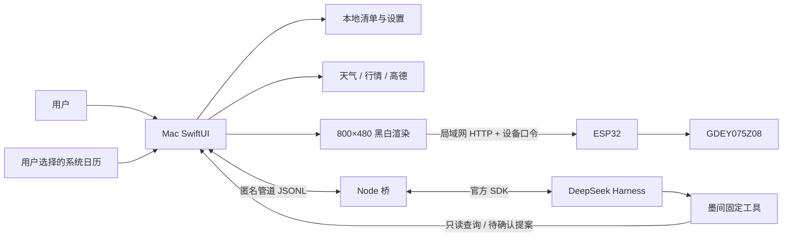

# 架构与刷新约定

## 主线数据流

Mac是数据与Agent宿主，ESP32负责显示和独立数据接收，不运行大模型。天气、行情与通勤来自真实接口；模型负责理解、整理和提出操作，不能编造查询结果。

## 核心边界

- `DeskStore`：本地状态、发送队列、退避重连、作息与提醒。
- `ScreenRenderer`：排版、固定红色预览与黑白发送帧。
- `DeviceTransport`：设备HTTP传输，可注入测试夹具。
- `HarnessBridge`：启动、匿名管道通信、请求代际、停止与120秒宿主超时。
- `AgentTools`：固定工具集、后台只读限制与人工确认提案。
- `CalendarFeed`：用户授权后读取选定日历；事件不自动加入模型上下文。
- 固件 `local_portal.h`：口令、metadata、位图、模式、布局版本和保留带校验。

## 显示格式

800×480 黑白帧为48000字节，行优先，每行100字节，高位在前。固定红色图案存Flash，不增加完整红色RAM缓存。Mac彩色预览使用相同生成器产生的资源；实际黑白上传单独渲染，红色带全白。

`mojian-red-v2` 使用 y=80至103行作为红色保留带。固件拒绝该带中的黑像素、普通局刷改变红色版本/样式或改变布局标识的请求。黑白更新窗口遇到红色带必须拆开避让。

差分刷新：previous=`0x13`、current=`0x10`，更新后同步previous RAM，`PT_SCAN=0`。同型号校正波形来源与GPL归属见参考资料。只有明确应用布局/模式或重启后建立基准等已定义流程全刷；普通待办、时钟、天气与股票变化不得静默全刷。

## 模式与冲突

原生Mac与手机都可向设备直写。手机独立模式停止旧Python服务画面轮询，防止旧帧覆盖。Mac重连不自动导入设备清单，不接管不同布局；读取清单与应用布局是明确操作。设备重启后若缺少局刷基准，需要明确应用一次全刷。

BLE用于发现并读取局域网地址，主要画面通过Wi-Fi传输。地址特征必须传字节与显式长度，避免C字符串指针重载只发送4字节。

## 持久化与提醒

`state.json`保存清单和设置；新功能字段使用可选字段兼容旧版本。完成记录保留，屏幕仅显示未完成事项。编辑保留任务ID；最多8项未完成、3项置顶，恢复也校验上限。

普通变化先保存到Mac，再排队同步；发送过程中再次编辑会合并最新快照。仅在画面与持久内容都相同时跳过上传。网络错误按5至60秒退避恢复，恢复只尝试允许的黑白局刷。

到期前10分钟与到期后24小时内分别判断通知；任务ID、截止时间、提醒阶段共同构成去重键。仅成功提交系统通知后记录到本地；系统是否实际展示仍受授权、专注模式与系统设置影响。应用关闭或睡眠时不执行检查，下次运行可补近期提醒；下班模式抑制工作提醒。

## 安全与产品状态

Key通过钥匙串和进程内存传递，不进入Git或模型上下文；地址只交给必要的数据接口，模型使用路线摘要。Agent禁用通用Shell、任意文件/目录、MCP资源工具；后台宿主再次限制只读。进程不是OS级沙箱，不能宣称达到沙箱隔离。

当前局域网HTTP＋设备口令适用于开发验证环境；正式销售仍需设备独立凭据、数据服务授权、签名公证、升级策略及长期实物测试。源码整理不改变这些验证边界。
