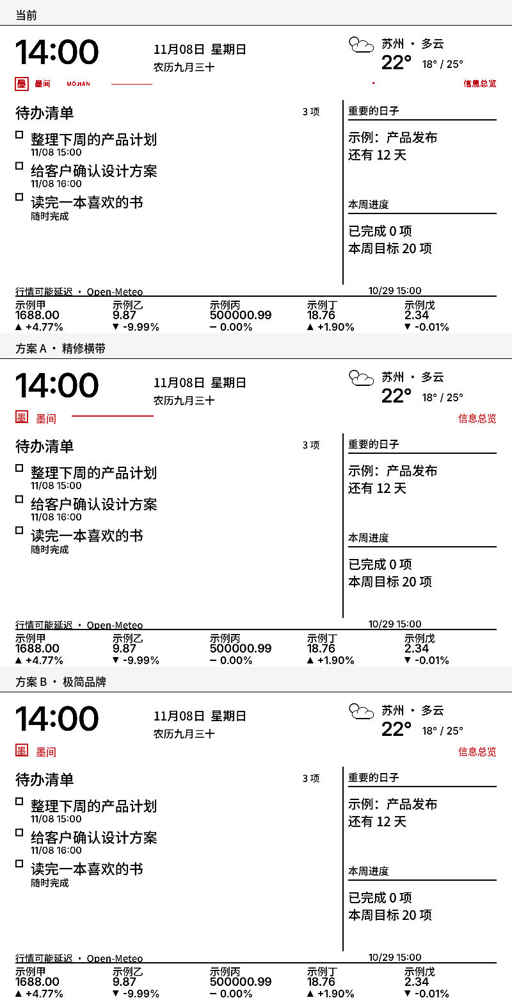

# 红色怎么安排：品牌横带方案研究

日期：2026-11-08。对象：800×480 黑白红墨水屏的固定红色装饰。红色不参与动态数据，只做品牌与当前模式标识。



## 现状盘点

红色只存在于 `y=80…103` 的保留横带，黑白平面该带必须全白；只有明确应用布局/模式时全刷才重绘红色，普通局刷窗口不得跨入。

当前横带里实际有五个元素：

1. 20×20 红方章，内写“墨”；
2. “墨间”13px；
3. “MOJIAN”9px；
4. 1px 短线（x=174…238）；
5. 右侧 13px 模式标签（如“信息总览”）；
6. 另有一颗 3×3 红点（x=582, y=88）。

八个布局各一份静态红色资源，每份约 **900–1000 个红像素**（占整个 800×480 的约 0.25%，横带面积约 5%）。红色是非常克制的，不需要再减少到“看不见”，但也经不起大块红或长细线。

## 约束

| 约束 | 影响 |
| --- | --- |
| 红色是独立颜料平面 | 只适合全刷；局刷只动黑白 |
| 红带 `y=80…103` 是固件契约 | 红色不能自然溢出到其他区域，否则要新版本/新掩膜 |
| 红像素约 0.25% | 已经是品牌点，不应变成大面积色块 |
| 红细线/大块红更易显残影 | 避免 800px 长的 1px 红线、避免大面积红底 |
| 红色不能是唯一状态指示 | 逾期/涨跌继续用黑色文字与符号，红色只做品牌 |
| 8 个布局 × 两端 | 改一次要同时重生成 Mac PNG 与固件 `STATIC_ACCENTS` |

## 方案对比

| 方案 | 红像素（横带内） | 优点 | 风险 |
| --- | --- | --- | --- |
| 当前 | 959 | 已有品牌感，红量低 | 9px `MOJIAN` 不可读；1px 线太细；红点像脏点 |
| **A · 精修横带** | **941 示意 / 实际 1096–1238** | 品牌更清楚，去掉噪声；实际字体比示意多约 15–20% 红像素 | 需要重生成 8 套资源 |
| B · 极简品牌 | 685 | 最安静，红最少 | 中间空白过大，横带“带”的感觉弱 |
| D · 整条红线 | 1437 | 横向锚点最强 | 752px 长细线，红像素增加约 50%，最不符合残影风险 |

### 推荐：A · 精修横带

保留现在的 24px 横带，只重排内容：

```text
y=80…103  白色底
x=24…44   20×20 红方章，2px 边，内写“墨”15px
x=56       “墨间”16px，红
x=112…240  2px 红线，y=88
x=776      右侧模式标签，15px，红，右对齐
```

删除：

- 9px `MOJIAN`（50cm 处基本不可读，且是红像素噪声）；
- 3px 孤立红点（看起来像印刷脏点，不承载信息）；
- 1px 短线（升级为 2px，长度 128px，位置左移，和品牌簇形成一组）。

保留：

- 红方章和“墨间”作为唯一品牌签名；
- 右侧模式标签，作为“当前布局”的静态标识；
- `y=80…103` 的保留带、全刷专属、红带全白约束；
- 红色只做品牌，不做逾期/涨跌/天气状态。

### 为什么不做 B 或 D

- B 的红最少，但左侧只剩方章和“墨间”，右侧标签又很远，横带会显得空；如果后续确认红残影与红量强相关，B 是安全的降级方案。
- D 把 752px 的 1px/2px 红线铺满，视觉上像“红色下划线”，但长细线正是最容易出现红条纹/扩散的形态之一；红像素增加约 50%，不值得。

## 实施步骤（若采用 A）

1. 修改 `tools/generate_static_accent.swift`：
   - 方章 `20×20`、`2px` 边、`墨` 15px；
   - `墨间` 16px，起点 x=56；
   - 删除 `MOJIAN` 与红点；
   - 短线改为 `x=112…240`、`y=88`、2px；
   - 模式标签 15px，右对齐到 776。
2. 运行：

   ```sh
   .venv/bin/python tools/generate_static_accent.py
   ```

   这会重生成 8 张 `macos/Resources/StaticAccent-*.png` 和 `firmware/src/static_accent.h`；`staticAccentWire` 仍是 bit 1 = 红。
3. Mac 预览用新 PNG；固件用新掩膜；Android 不绘制红色，不需要改资源。
4. 保留 `mojian-red-v2`：横带位置与协议未变，只改图案；若希望把这次视觉也纳入版本契约，再单独讨论 v3。
5. 应用一次明确全刷；之后普通局刷仍避开 `y=80…103`。
6. 实屏确认：品牌红是否清晰、右侧标签是否过大、横带是否仍全白；不自动全刷。

## 验证

- `static_accent` 生成脚本会打印每套掩膜的红像素数；A 应接近 940，不能异常膨胀。
- `static_accent_test.cpp` / C++ 回归检查红带与窗口避让。
- Mac `--render-previews docs/images` 重新生成虚构预览。
- 固件编译；实屏照片确认后再更新 VALIDATION。
- 任何红带/字体/线宽变化都不能替代光学确认。

## 结论

红色应该继续“少而固定”：一个方章、一个“墨间”、一条 128px 的 2px 短线、一个右对齐模式标签。这样红量与当前几乎相同，但去掉了不可读的 9px 字、过细的 1px 线和孤立红点。方案 A 是当前最平衡的安排。

## 实施结果（2026-11-08）

- 已按 A 修改生成器并重生成 8 套 Mac PNG 与固件 `STATIC_ACCENTS`；实际红像素 1096–1238，仍约占整屏 0.3%。
- Mac 预览/测试通过；`esp32-l-gx-full-temp-ab` 烧录 hash verified，全刷 `08cf1f67-00000001` completed，等待 29.66 秒，基准/布局/清单保留、无故障/超时。
- 本次使用旧布局帧全刷，只验证红色资源；8px 网格布局仍需客户端明确应用一次。实屏观感待用户确认。

## 上屏验证（2026-11-08）

- 红色资源已随温度块固件上屏；120 秒只读观察 12 个样本、0 读错误/重启、2 个差分窗口完成，基准有效。
- 新 8px 网格首次全刷后被运行中的旧 Mac 客户端自动同步覆盖；退出旧客户端后重新全刷（`78414538-0000001a` completed），新网格实际上屏：544/232 右栏、两段页脚。
- 新网格按 Mac 状态渲染，右栏“生长小盆栽”从手机端的 2/20 变为 0/20（设备 HTTP 无手机本机统计）。旧客户端已停止；需要 2/20 时由手机端应用布局。实屏红色与新网格观感待用户确认。

### 区域测试（2026-11-08）

- 新网格上屏后 5 分钟/30 样本：红带全白、0 读取错误/重启/故障；唯一局刷变化 142 字节，全在时钟区。
- 新客户端重连只改变 239 字节，仍在时钟区，未把布局写回旧版；120 秒带客户端观察无故障。
